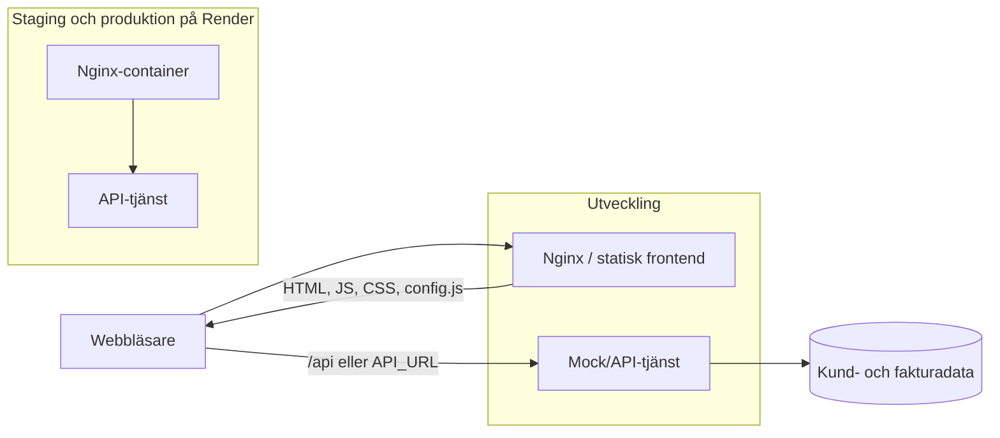
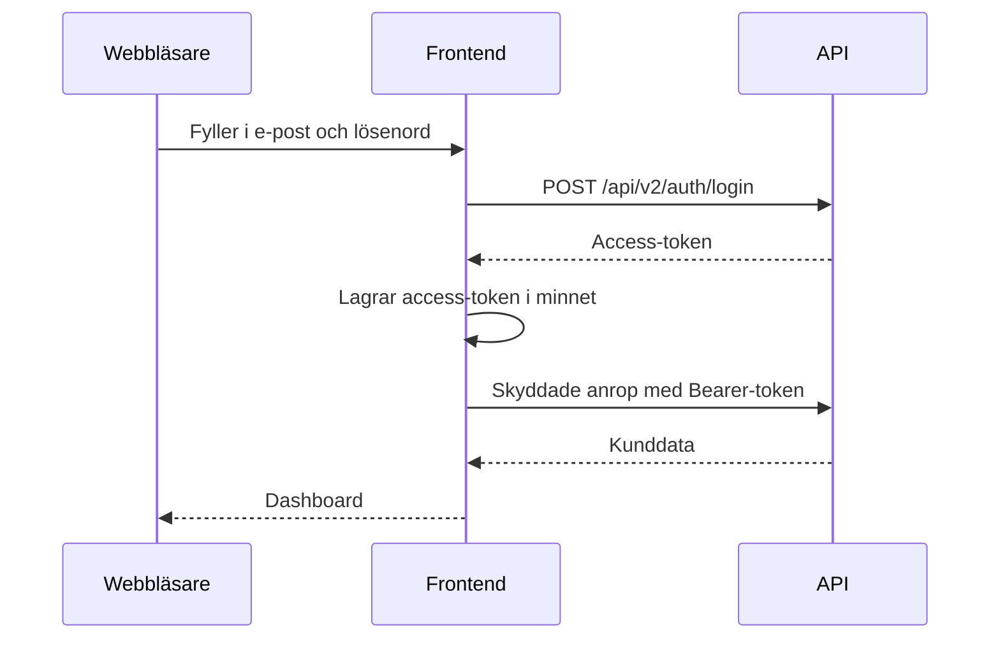

# Arkitektur – Kraftly Mina sidor

## Översikt

Frontend byggs som statiska filer och serveras av Nginx. Webbläsaren hämtar
konfiguration och bundle från samma origin och anropar API:t via den
konfigurerade API-adressen. Lokalt körs Nginx/Compose eller Vite och mock-API;
staging och produktion kör samma publicerade image på Render.

## Lagren i frontend

| Lager                | Ansvar                                                | Regel                                                              |
| -------------------- | ----------------------------------------------------- | ------------------------------------------------------------------ |
| Views och components | Rendera vyer, formulär och tillgängliga interaktioner | UI ska kommunicera via props/events och återanvändbara komponenter |
| Router               | Navigering och skydd av inloggade routes              | Route guard är UX; API:t är alltid den verkliga åtkomstkontrollen  |
| Stores               | Delat användar- och applikationstillstånd             | Access-token lagras i minnet, inte i `localStorage`                |
| Services             | API-anrop, headers och felhantering                   | Anrop går genom den centrala API-klienten                          |
| Utils/config         | Feature flags och miljöberoende konfiguration         | Publik config får aldrig innehålla hemligheter                     |

## Miljöer

| Miljö      | Körning                                      | Syfte                         | Konfiguration                     |
| ---------- | -------------------------------------------- | ----------------------------- | --------------------------------- |
| Dev        | Vite + mock-API lokalt, eller Docker Compose | Utveckling och lokal testning | `.env` från `.env.example`        |
| Staging    | Render, samma image som produktion           | Verifiering före release      | Render/GitHub-miljön `staging`    |
| Produktion | Render, samma verifierade image              | Kundtrafik och demo           | Render/GitHub-miljön `production` |

## Beslut

De viktigaste arkitekturbesluten finns i [beslutsindexet](decisions/README.md):
SPA-rendering, hosting på Render, tokenlagring, runtime feature flags och
Cypress för E2E.

## Ett flöde: inloggningen

